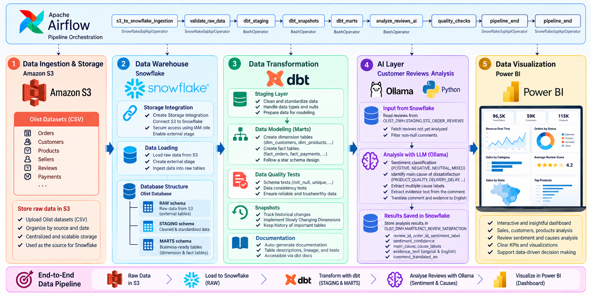
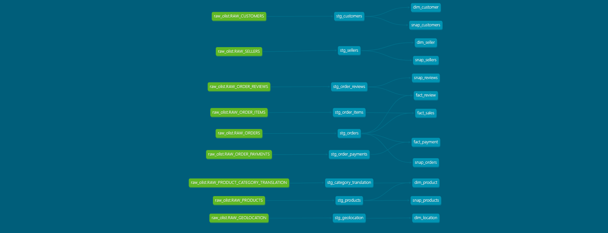
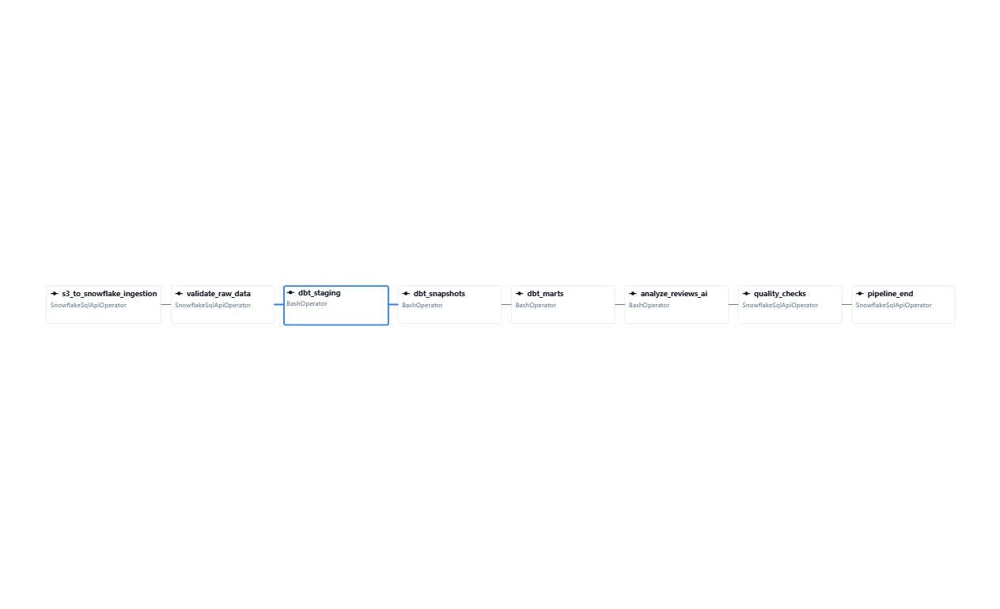

<div align="center">

# 🛒 Olist E-Commerce | End-to-End Data Engineering & AI Analytics

### From Amazon S3 to actionable business intelligence: Snowflake · dbt · Apache Airflow · Ollama · Power BI

**Cloud Data Warehouse · ELT · Dimensional Modeling · Data Quality · LLM-Powered Review Analytics · Workflow Orchestration · BI**

</div>

---

## 📌 Project Overview

This project implements an **end-to-end data engineering and AI analytics pipeline** using the **Brazilian Olist e-commerce dataset**. It turns operational e-commerce data into a structured, analytics-ready warehouse, enriches customer reviews with AI-generated insights, and presents the results through interactive Power BI reports.

The solution covers the full lifecycle: **cloud object storage → secure ingestion → data warehousing → transformation and testing → AI enrichment → orchestration → visualization**.

### Project objectives

- Centralize multi-table e-commerce data in a cloud data warehouse.
- Build clean, reusable staging models and analytics-ready dimensional models.
- Add data quality checks, snapshots, and dbt documentation.
- Enrich customer reviews with **sentiment, dissatisfaction causes, evidence excerpts, and English translations** using an LLM.
- Orchestrate the processing stages with Apache Airflow.
- Deliver dashboards for executive KPIs, sales performance, and customer experience.

## 🏗️ End-to-End Architecture



The architecture has five connected layers:

| Layer | Technologies | Main responsibilities |
|---|---|---|
| **1. Data storage** | Amazon S3 | Store source CSV datasets in cloud object storage. |
| **2. Data warehouse** | Snowflake | Configure S3 access, load source data, and organize `RAW`, `STAGING`, and `MARTS` schemas. |
| **3. Transformation** | dbt | Clean and standardize data, create dimensions and facts, run tests, maintain snapshots, and generate documentation. |
| **4. AI enrichment** | Python, Ollama, `gpt-oss:120b-cloud` | Analyze reviews, classify sentiment, identify causes, extract evidence, and translate comments into English. |
| **5. Analytics** | Power BI | Explore operational performance, sales, customers, delivery, and customer satisfaction. |

**Apache Airflow** orchestrates the processing steps across the pipeline. Power BI is the downstream reporting layer.

> **Architecture note:** Airflow orchestrates the ingestion, transformation, AI analysis, and quality-check tasks. Power BI reports are built on the prepared analytical data; dashboard design is not represented as an Airflow task.

## 🧰 Technology Stack

| Category | Tools |
|---|---|
| Cloud object storage | Amazon S3 |
| Cloud data platform | Snowflake, Snowflake SQL |
| ELT and analytics engineering | dbt |
| Workflow orchestration | Apache Airflow, Docker Compose |
| AI / LLM integration | Python, Ollama, `gpt-oss:120b-cloud` |
| Data access and configuration | Snowflake Python Connector, `python-dotenv` |
| Business intelligence | Microsoft Power BI |
| Version control | Git, GitHub |

---

## 1. 📦 Source Data and Amazon S3

The project uses the **Olist Brazilian E-Commerce dataset**, which contains related datasets covering orders, customers, products, sellers, order items, payments, reviews, geographic information, and product-category translations.

The original CSV files are organized in **Amazon S3**, which serves as the cloud ingestion source. Snowflake then loads the datasets into its raw warehouse layer.

**Why S3?** It separates source-file storage from warehouse compute, provides a central ingestion location, and supports repeatable loading through Snowflake external stages.

## 2. ❄️ Snowflake Data Warehouse

The Snowflake environment includes the `OLIST_DWH` database and the following main schemas:

| Schema | Purpose |
|---|---|
| `RAW` | Landing tables containing data loaded from the source CSV files. |
| `STAGING` | Cleaned and standardized datasets produced by dbt. |
| `MARTS` | Business-oriented dimensional models and the AI-enriched review satisfaction table. |
| `SNAPSHOTS` | Historical records maintained through dbt snapshots. |

### S3-to-Snowflake ingestion

The warehouse setup includes:

1. Creating the warehouse, database, and schemas.
2. Defining CSV file formats.
3. Creating raw destination tables.
4. Configuring an **S3 storage integration** and external stage with appropriate cloud access permissions.
5. Loading source files into Snowflake using SQL ingestion commands.
6. Preparing database objects for the analytics and AI layers.

The SQL setup scripts are located in [`Snowflake/`](Snowflake/).

> **Security:** The storage integration and IAM permissions should use appropriately scoped access. Never publish AWS credentials, Snowflake passwords, API keys, or other secrets in this repository.

## 3. 🔶 dbt: Transformation, Modeling, and Data Quality

The dbt project transforms the raw datasets into reliable analytical models and maintains the data-model documentation.

### dbt lineage graph



### Staging layer

The staging models standardize source data, handle relevant nulls and types, and expose consistent fields for downstream analytics.

Models include:

`stg_customers` · `stg_orders` · `stg_order_items` · `stg_order_payments` · `stg_order_reviews` · `stg_products` · `stg_sellers` · `stg_geolocation` · `stg_category_translation`

### Dimensional modeling: marts

The analytical layer uses a **star-schema-oriented approach**, with reusable dimensions and fact tables.

| Model type | Implemented models |
|---|---|
| Dimensions | `dim_customer`, `dim_product`, `dim_seller`, `dim_location`, `dim_date` |
| Facts | `fact_sales`, `fact_payment`, `fact_review` |
| AI-enriched fact table | `FACT_REVIEW_SATISFACTION` (populated by the Python AI process) |

The resulting marts support analysis of transactions, payments, customer reviews, products, sellers, and geographic dimensions.

### Tests and data quality

The dbt project contains schema-based tests and metadata definitions to help validate analytical data. Examples of checks include **not-null**, **uniqueness**, and relevant data consistency constraints, according to the models' configuration.

The Airflow DAG also contains explicit raw-data validation and final quality-check tasks.

### Snapshots

The project includes snapshots for customers, orders, products, reviews, and sellers:

` snap_customers` · `snap_orders` · `snap_products` · `snap_reviews` · `snap_sellers`

Snapshots provide a mechanism for recording historical changes in tracked records. They are a **separate historical layer**; their presence does not imply that every mart reads from snapshot tables.

### Documentation

The dbt project contains source definitions, model metadata, and generated documentation capabilities. The lineage graph helps visualize dependencies among sources, staging models, and downstream models.

To generate and inspect documentation from the dbt project directory:

```powershell
cd D:\projects\Olist_project\dbt\olist_dbt
dbt deps
dbt docs generate
dbt docs serve
```

Use the local URL shown by the `dbt docs serve` command.

---

## 4. 🧠 AI Layer: Customer Review Intelligence

Rather than relying exclusively on numerical review scores, the project analyzes **written customer feedback** to produce structured customer-experience insights.

**Implementation:** [`ai_review_analysis.py`](ai_review_analysis.py) uses Python, the Snowflake connector, and the Ollama client with the **`gpt-oss:120b-cloud`** model.

### Processing workflow

1. **Read pending reviews:** Retrieve reviews from `OLIST_DWH.STAGING.STG_ORDER_REVIEWS` whose comments are non-empty and which are not yet present in the results table.
2. **Batch LLM inference:** Send review records to Ollama in batches of **20**.
3. **Classify sentiment:** Assign one of `POSITIVE`, `NEGATIVE`, `NEUTRAL`, or `MIXED`, with a model-provided confidence score.
4. **Identify causes:** Select a primary cause and optional additional cause labels from a controlled taxonomy.
5. **Extract supporting evidence:** Preserve a short excerpt found in the original review.
6. **Translate into English:** Generate English translations of the full comment and its evidence excerpt, while retaining the original text.
7. **Validate structured output:** Parse JSON and check sentiment labels, confidence bounds, allowed causes, field types, and whether evidence appears in the source comment.
8. **Persist results:** Insert validated records into `OLIST_DWH.MARTS.FACT_REVIEW_SATISFACTION`.
9. **Handle reviews without comments:** Insert a rule-based `NO_COMMENT` / `NO_REASON` record without calling the LLM.

### Cause taxonomy

The implementation supports these categories:

`PRODUCT_QUALITY`, `PRODUCT_DESCRIPTION`, `PRODUCT_SIZE`, `DELIVERY_DELAY`, `DELIVERY_SPEED`, `DAMAGED_PACKAGE`, `PACKAGING`, `PRICE_VALUE`, `PAYMENT`, `CUSTOMER_SERVICE`, `ORDER_ACCURACY`, `PRODUCT_SATISFACTION`, `OTHER`, `NO_REASON`.

### Output table

The AI-enriched fact table stores fields including:

| Field | Meaning |
|---|---|
| `review_id`, `order_id` | Source review and order identifiers |
| `review_score` | Original numeric rating |
| `comment_original` | Original customer comment |
| `comment_translated_en` | Full English translation |
| `sentiment_label` | Positive, negative, neutral, or mixed |
| `sentiment_confidence` | LLM-reported confidence in `[0, 1]` |
| `main_cause` | Primary cause category |
| `cause_labels` | Additional cause categories |
| `evidence_text`, `evidence_text_en` | Supporting original excerpt and translation |
| `model_name`, `analysis_timestamp` | Model provenance and processing timestamp |

### Incremental processing behavior

The script checks whether a review/order combination has already been processed and avoids reinserting existing analysis keys. This reduces unnecessary repeat LLM calls on subsequent runs. Invalid or missing model outputs are skipped rather than silently stored.

> **AI scope:** This is **prompt-based LLM analysis**, not a separately trained sentiment classifier. Confidence values are model-generated, not independently calibrated probabilities. The code validates output structure and selected consistency rules; it does not independently verify the semantic accuracy of every classification or translation.

---

## 5. 🌬️ Apache Airflow Orchestration

Airflow coordinates the core pipeline tasks, from source ingestion through AI enrichment and quality checks.

### Actual DAG graph



The DAG `olist_pipeline` follows this sequence:

```text
s3_to_snowflake_ingestion
            ↓
     validate_raw_data
            ↓
        dbt_staging
            ↓
       dbt_snapshots
            ↓
         dbt_marts
            ↓
      analyze_reviews_ai
            ↓
       quality_checks
            ↓
        pipeline_end
```

| Airflow task | Role |
|---|---|
| `s3_to_snowflake_ingestion` | Load source data from S3 into Snowflake. |
| `validate_raw_data` | Validate the raw ingestion layer. |
| `dbt_staging` | Run dbt staging transformations. |
| `dbt_snapshots` | Update tracked historical snapshots. |
| `dbt_marts` | Build analytical marts. |
| `analyze_reviews_ai` | Run the customer review AI enrichment script. |
| `quality_checks` | Perform final warehouse quality checks. |
| `pipeline_end` | Mark the end of the workflow. |

The DAG combines Snowflake SQL operators and shell-based tasks, as shown in the Airflow graph. The DAG definition is available at [`airflow/dags/olist_pipeline.py`](airflow/dags/olist_pipeline.py).

### Local Airflow setup

The repository includes a Docker Compose configuration for a local Airflow deployment. With Docker Desktop running:

```powershell
cd D:\projects\Olist_project\airflow

docker compose config --services
docker compose up airflow-init   # First-time initialization
docker compose up -d
docker compose ps
```

Then open **http://localhost:8080** and inspect `olist_pipeline` in the **Graph** view.

> **Important:** The provided Compose configuration uses Airflow 3 and multiple services (including PostgreSQL, Redis, scheduler, DAG processor, API server, and worker). It needs sufficient Docker/WSL memory. The DAG also depends on valid Snowflake connections, mounted project files, dbt, Python packages, and AI service configuration before actual execution. Merely opening the graph does **not** execute the pipeline.

To stop the stack without deleting persistent volumes:

```powershell
docker compose down
```

---

## 6. 📊 Power BI: Analytics and Business Reporting

The final layer presents warehouse metrics and AI-enriched customer feedback through **three Power BI report pages**.

### Executive Overview


A high-level view of business activity and key performance indicators for decision-makers.

### Sales & Performance Analysis


A detailed exploration of sales patterns and business performance across relevant dimensions.

### Service Quality & Customer Experience


A customer-focused view combining review sentiment, dissatisfaction causes, delivery performance, and payment-related analysis.

Together, these pages demonstrate how operational records and AI-enriched feedback can support business monitoring and investigation.

---

## 📊 Project Results & Key Metrics

The end-to-end pipeline successfully transformed Brazilian Olist e-commerce data into structured analytical models and AI-enriched customer insights.

### 🔹 Data Processing & Engineering

| Metric | Result |
|---|---:|
| E-commerce orders processed | **99,441** |
| dbt models developed | **17** |
| dbt snapshots implemented | **5** |
| Data sources configured in dbt | **9** |
| dbt data quality tests passed | **9 / 9 (100%)** |
| Test failures and warnings | **0** |

The dbt tests validate `not_null` and `unique` constraints on selected staging columns, ensuring data completeness and uniqueness for key fields.

### 🔹 AI-Powered Customer Review Analysis

Using **Python, Ollama, and the `gpt-oss:120b-cloud` LLM**, the AI layer analyzed **40,865 customer reviews** to classify sentiment, identify dissatisfaction causes, extract supporting evidence, and translate customer feedback into English.

| Sentiment | Reviews | Percentage |
|---|---:|---:|
| 🟢 Positive | 23,815 | 58.3% |
| 🔴 Negative | 12,935 | 31.7% |
| 🟠 Mixed | 2,757 | 6.7% |
| 🔵 Neutral | 1,358 | 3.3% |
| **Total** | **40,865** | **100%** |

### 🔹 Business Value

- **Customer Experience:** Identified negative customer feedback and structured dissatisfaction causes for further analysis.
- **Data Reliability:** Validated all 9 configured dbt tests without errors or warnings.
- **Analytics Readiness:** Built dimensional and fact models to support business intelligence reporting.
- **AI-Enriched Insights:** Converted unstructured customer reviews into structured analytical data stored in Snowflake.
- **Decision Support:** Developed three Power BI report pages covering executive performance, sales analytics, and customer experience.

> **Validation note:** The dbt data quality tests completed successfully (9/9 passed). The Airflow DAG has been configured and visualized; a complete end-to-end DAG execution has not yet been validated.

## 📁 Repository Structure

```text
Olist_project/
├── README.md
├── .env.example
├── .gitignore
├── Snowflake/
│   ├── 1_setup.sql
│   ├── 2_file_format.sql
│   ├── 3_create_row_tables.sql
│   ├── 4_create_stage.sql
│   ├── 5_copy_into.sql
│   ├── 6_setup_bi.sql
│   ├── 7_ai_layer.sql
│   └── 8_test_marts.sql
├── dbt/
│   └── olist_dbt/
│       ├── dbt_project.yml
│       ├── packages.yml
│       ├── models/
│       │   ├── staging/
│       │   └── marts/
│       │       ├── dims/
│       │       └── facts/
│       ├── snapshots/
│       ├── macros/
│       └── tests/
├── airflow/
│   ├── docker-compose.yaml
│   ├── dags/
│   │   └── olist_pipeline.py
│   └── config/
├── ai_review_analysis.py
└── docs/
    ├── Pipeline_Olist_ingestion_IA_et_visualisation.png
    ├── dbt-dag.png
    ├── olist_pipeline-graph.png
    ├── BI_Executive Overview.jpg
    ├── BI_Sales & Performance Analysis.jpg
    └── BI_Service Quality & Customer Experience.jpg
```

> The tree highlights the main source files and documentation assets; generated files, local virtual environments, and credentials should not be committed.


## 🚀 Getting Started

### Prerequisites

- Python and a compatible virtual environment
- A Snowflake account and warehouse permissions
- An S3 bucket and an appropriately configured Snowflake storage integration
- dbt with the Snowflake adapter
- Docker Desktop with working WSL2 support (for the Airflow stack on Windows)
- Ollama client access to the configured model
- Power BI Desktop to open or extend reports

### 1. Clone the repository

```bash
git clone https://github.com/YOUR_USERNAME/YOUR_REPOSITORY.git
cd YOUR_REPOSITORY
```

Replace the placeholders with the actual repository URL and folder name.

### 2. Configure environment variables

Copy `.env.example` to a local `.env` and supply the required values. The AI script expects these variable names:

```dotenv
SNOWFLAKE_ACCOUNT=
SNOWFLAKE_USER=
SNOWFLAKE_PASSWORD=
SNOWFLAKE_WAREHOUSE=
SNOWFLAKE_DATABASE=
SNOWFLAKE_ROLE=
OLLAMA_API_KEY=
```

Keep `.env` out of version control. Other components (dbt, Airflow, S3 integration) may require additional credentials and connection configuration.

### 3. Prepare Snowflake and S3

Review the numbered scripts in [`Snowflake/`](Snowflake/) and execute them **in dependency order**, adapting database roles, cloud integration settings, bucket paths, and permissions to your environment.

### 4. Run dbt transformations

From the dbt project directory, with a working Snowflake dbt profile:

```powershell
cd dbt\olist_dbt
dbt deps
dbt debug
dbt run
dbt snapshot
dbt test
dbt docs generate
```

> Use the appropriate shell path syntax for your operating system. The project's actual Airflow task sequence runs staging, snapshots, and marts as separate steps.

### 5. Run AI review enrichment

With Python dependencies installed, Snowflake connectivity configured, and Ollama access available:

```powershell
python ai_review_analysis.py
```

The script analyzes only eligible, not-yet-processed reviews and inserts validated results into `MARTS.FACT_REVIEW_SATISFACTION`.

### 6. Run Airflow orchestration

Use the Docker Compose setup described in the Airflow section. Configure Airflow connections and ensure its containers can reach the required Snowflake, dbt, Python, and Ollama services before triggering the DAG.

### 7. Explore Power BI dashboards

Use the report screenshots in [`docs/`](docs/) for a visual overview. If the `.pbix` report is provided separately, open it in Power BI Desktop and configure its Snowflake connection as needed.

---

## 🔍 Engineering Highlights

- **Separation of concerns:** Cloud file storage, warehouse schemas, transformation models, AI processing, orchestration, and visualization have distinct responsibilities.
- **Modular transformations:** dbt staging and marts create a reusable analytics layer.
- **Traceable lineage:** dbt documentation and Airflow graph make dependencies easier to inspect.
- **Data reliability:** Schema tests, validation tasks, and AI output checks reduce the risk of propagating malformed data.
- **Historical tracking:** dbt snapshots support change tracking for selected source entities.
- **Cost-aware AI processing:** Batch inference and skipping already-processed reviews reduce repeated model calls.
- **Explainable review signals:** Structured cause labels are accompanied by excerpts from original customer comments.
- **Business-ready delivery:** Power BI reports connect technical outputs to operational and customer-experience questions.

## 📈 Potential Extensions

Future improvements could include automated CI checks for dbt, richer monitoring and alerts for Airflow, stricter LLM response-schema validation, evaluation of sentiment/cause classification quality on a labeled sample, and automated deployment of BI artifacts.

## 📚 Data and Tools

- [Olist Brazilian E-Commerce Public Dataset](https://www.kaggle.com/datasets/olistbr/brazilian-ecommerce)
- [Amazon S3](https://aws.amazon.com/s3/)
- [Snowflake](https://www.snowflake.com/)
- [dbt](https://www.getdbt.com/)
- [Apache Airflow](https://airflow.apache.org/)
- [Ollama](https://ollama.com/)
- [Microsoft Power BI](https://powerbi.microsoft.com/)

---

<div align="center">

**End-to-end data engineering, LLM-powered customer intelligence, and business analytics — built around the Olist e-commerce dataset.**

</div>
